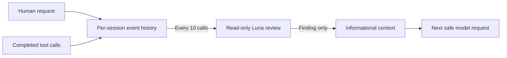

# Codex supervisor: observer and goal mode

Codex has two independent, opt-in features:

- **Observer** — reviews recent activity against the current request, project
  instructions, delegation evidence, and focus. It stays quiet when work is on
  track. When it finds a concrete issue, it adds a short correction as
  informational context. It does not block tool calls or force another turn.
- **Goal mode** — infers one falsifiable completion condition for the turn,
  then judges it on `Stop`. An incomplete verdict returns a Codex
  `{"decision":"block","reason":...}` response, so the agent continues. This is
  the only Codex path that deliberately forces another turn.

Both features share the per-session state under `.supervisor/sessions/`. Goal
mode is off unless `.supervisor/codex.json` explicitly enables it.

## Install on macOS

Requirements:

- Node.js 18 or newer available as `node` in the shell.
- A local Codex runtime and an authenticated Codex CLI. The ChatGPT desktop
  CLI is auto-detected at its standard macOS path; otherwise `codex` must be on
  `PATH` or `CODEX_BINARY` must point to the executable.
- An active Codex login for the bundled `gpt-6-luna` reviewer. Each review is
  a model request and uses the account's available quota.

Clone the repository, enter it, then install the runtime and register its
native hooks for the current Codex home. Pass the project path where the
supervisor should be enabled:

```sh
git clone --branch codex/codex-progress-observer https://github.com/dzianisv/agents-supervisor
cd agents-supervisor
node bin/install-codex.mjs --project "/absolute/path/to/your/project"
```

The Codex integration is on its feature branch until that branch is merged.

The installer copies the hook runtime into the Codex local-plugins directory,
merges its hook groups into the native hooks file, and enables the observer in
that project's `.supervisor/codex.json`. It preserves other registered hooks
and makes a private backup before replacing existing JSON files. The native
hooks file lives under `$CODEX_HOME` when set, or `~/.codex` by default. The
installer does not bypass hook trust. To trust the registered commands, open
the interactive Codex CLI for the project:

```sh
"/Applications/ChatGPT.app/Contents/Resources/codex-cli/bin/codex" --no-alt-screen --cd "/absolute/path/to/your/project"
```

If you use the standalone CLI, run `codex --no-alt-screen --cd
"/absolute/path/to/your/project"` instead. Wait for the CLI to reach its main
composer, enter `/hooks`, review the listed commands, and trust the commands
for this plugin. Then restart ChatGPT desktop and start a new local chat.
Marketplace installation alone has not been verified to activate these native
hooks; use the installer above.

The hook files are local to the machine. Installing them does not turn on the
observer or goal mode in other projects. To enable another project, run the
installer with that project's path. To disable the observer for one project,
set `observer.enabled` to `false`. To disable goal mode, set `goal.enabled` to
`false` (or remove the `goal` block). A top-level `"enabled": false` disables
both features. To uninstall the machine-wide hooks and runtime and disable the
project named on the command line, run from the cloned repository:

```sh
node bin/install-codex.mjs --uninstall --project "/absolute/path/to/your/project"
```

Uninstall removes only this plugin's hook entries and runtime; other hooks are
kept. If you enabled other projects too, their `.supervisor/codex.json` settings
remain enabled, but they will have no supervisor runtime until you install it
again. The project's recorded review and goal state is kept.

## Configuration

The observer is off unless `.supervisor/codex.json` explicitly enables it.
Goal mode is a separate opt-in block:

```json
{
  "observer": {
    "enabled": true,
    "everyToolCalls": 10
  },
  "goal": {
    "enabled": true,
    "infer": true,
    "judgeOnStop": true,
    "maxAttempts": 50
  }
}
```

- `observer.everyToolCalls` accepts an integer from 1 to 100 and defaults to
  10. The count starts over with each new human turn.
- `goal.enabled` defaults to `false`. It requires the top-level `enabled` value
  to be absent or `true`.
- `goal.infer` defaults to `true`. When off, a goal is only used if the session
  already has one or the project has `.agents/supervisor/Goal.md`.
- `goal.judgeOnStop` defaults to `true`. When off, `Stop` still handles the loop
  exit sentinel and no-progress gate but does not call the completion judge.
- `goal.maxAttempts` is the runaway safety valve for this project. A positive
  integer is honoured verbatim; `unlimited` / `off` / `none` / `0` removes the
  cap. Without it, Codex reads `maxAttempts:` from the shared supervisor config
  and then `SUPERVISOR_MAX_ATTEMPTS` / `REFLECTION_CC_MAX_ATTEMPTS`, defaulting
  to 50. This is a backstop, not a budget to spend.

Hook events and bounded state stay under the project's `.supervisor/sessions/`
directory. Recent requests, instruction text, tool inputs, and tool results in
each review are sent to the bundled reviewer through the active Codex login;
those contents are part of the model request.

## Observer behavior

It records each human request and completed tool call in per-session state.
After each configured number of completed calls in the current turn (10 by
default), it starts a background review. One review is scheduled at a time for
that turn; a result from an earlier turn is discarded. The reviewer receives
recent human requests, applicable `AGENTS.md` text, recent tool inputs and
results, delegation activity present in those events, and the latest assistant
reply when available. This is a bounded recent-history snapshot, not the full
conversation or a live view of the repository.



The review runs in a separate, short-lived Codex CLI process. It explicitly
uses `gpt-6-luna`; your active session keeps its own selected model. The review
process gets the bounded snapshot described above, runs with a read-only
sandbox, and has shell, hooks, plugins, and delegation disabled. It returns a
structured finding; it does not inspect or change project files itself. Only a
concrete finding becomes informational context for the active session.

Delegation is allowed, including nested delegation. The observer does not infer
root or child status from a model name or session id, and it does not require
every task to be delegated. It may suggest delegation when observed work and
assigned scope support that suggestion, but it does not block or rewrite a
delegation call.

## Goal mode behavior

Goal mode turns one user turn into a bounded goal loop.

1. **Derivation.** After the first completed tool call in a turn, if the session
   and project have no goal, the hook sends a bounded snapshot to the same
   isolated reviewer. It asks for one concrete, falsifiable condition, or an
   explicit refusal. A refusal sets no goal. The inferred goal is stored in
   session state with `source: "inferred"`; it is never written to
   `.agents/supervisor/Goal.md`.
2. **Adoption.** If `.agents/supervisor/Goal.md` (or `goal.md`) already exists,
   it is adopted as the session goal with `source: "project"`. A project goal
   is durable; an inferred goal is not.
3. **Stop judging.** With an active goal, `Stop` first handles the explicit
   loop-exit sentinel and the repeated-reply no-progress gate. Otherwise it
   sends the condition, the latest assistant reply, recent tool evidence, and
   applicable `AGENTS.md` text to the reviewer.
4. **Complete.** A complete verdict requires evidence. It clears an inferred
   session goal, or retires a project goal only if the file still holds the
   exact judged condition. The achievement is recorded in
   `.supervisor/goal-achieved.log`.
5. **Incomplete.** The attempt counter advances and `Stop` returns
   `{"decision":"block","reason":...}`. The reason contains the reviewer's
   concrete correction and the line-anchored
   `SUPERVISOR_LOOP_EXIT: completed` hint.
6. **Cap or deadline.** The goal is persisted as `exhausted` with a resume hint;
   the hook returns no block. This is a safety valve, not a completion claim.
7. **Sentinel.** `SUPERVISOR_LOOP_EXIT: completed` stops without judging and
   leaves an active goal untouched. `SUPERVISOR_LOOP_EXIT: stuck — reason`
   pauses the goal and appends to `.supervisor/loop-exit.log`.
8. **Reviewer failure.** The hook fails open: no block, the goal stays active,
   and a `goal-review-warning` audit record is written. It never fabricates a
   completion.

A paused or exhausted goal is resumed through the shared CLI, using the session
id from the Codex hook:

```sh
node "$CODEX_HOME/local-plugins/agents-supervisor/bin/supervisor.mjs" \
  set-goal resume --session "<session-id>"
```

Run that from the project root. The pause reason includes the same command with
the actual session id, so an agent that can run shell commands has a concrete
recovery path.

## Hook behavior and limits

The native hooks are `UserPromptSubmit`, wildcard `PostToolUse` with
`async: true`, and `Stop`. Prompt submission saves the current request, tool
events build the review snapshot and may derive a goal, and `Stop` saves the
latest assistant reply and may judge the goal. If the runtime omits
`last_assistant_message`, the hook reads the final assistant message from the
`transcript_path` rollout instead. The `Stop` timeout is 120 seconds; the
bundled reviewer defaults to a 45-second deadline, leaving time for process
cleanup. Errors are recorded quietly and do not block tool execution. Repeated
identical observer feedback is suppressed for that session.

`Stop` continuation depends on the Codex runtime honouring
`{"decision":"block"}` from a `Stop` hook. This is verified against the embedded
Codex CLI with a local Responses fixture: the hook's block produces a real
continuation request and keeps the same `turn_id`. A runtime that ignores the
decision still cannot force a continuation even though the hook returns it; the
failure is visible in the audit log rather than silently claimed as success.
Desktop/runtime-specific behavior outside the embedded CLI is not assumed.

The repository also contains `.codex-plugin/plugin.json` and
`hooks/codex-hooks.json` as a plugin packaging overlay. Current validation
covers native hooks registered by the installer. It does not establish that
marketplace or bundled-plugin installation discovers these hook scripts in
every Codex desktop/runtime version.

## Validation

The native Codex E2E uses an isolated `CODEX_HOME`, a local Responses API
fixture, and a local reviewer executable. It does not use account credentials
or paid model calls. Run:

```sh
node --experimental-strip-types --test test/e2e-codex.test.mjs
```

`CODEX_BINARY` can select a Codex executable for the E2E. The test verifies
native hook dispatch and informational feedback, not plugin-bundled hook
discovery. Hook definitions still require review and trust in Codex. Unit and
hook-level goal tests run without credentials:

```sh
node --test test/codex-goal.test.mjs test/codex-review.test.mjs
```

## References

- [Codex hooks](https://learn.chatgpt.com/docs/hooks)
- [Package a plugin](https://developers.openai.com/plugins/build/plugins)
