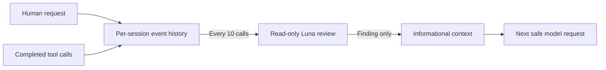

# Codex progress observer

The Codex observer checks recent activity against the current request, project
instructions, delegation evidence, and focus. It stays quiet when work is on
track. When it finds a concrete issue, it adds a short correction as
informational context. It does not block or rewrite tool calls, force another
turn, or wake an idle session.

## Install on macOS

Requirements:

- Node.js 18 or newer available as `node` in the shell.
- A local Codex runtime and an authenticated Codex CLI. The ChatGPT desktop
  CLI is auto-detected at its standard macOS path; otherwise `codex` must be on
  `PATH` or `CODEX_BINARY` must point to the executable.
- An active Codex login for the bundled `gpt-6-luna` reviewer. Each review is
  a model request and uses the account's available quota.

Clone the repository, enter it, then install the runtime and register its
native hooks for the current Codex home. Pass the project path where the
observer should be enabled:

```sh
git clone --branch codex/codex-progress-observer https://github.com/dzianisv/agents-supervisor
cd agents-supervisor
node bin/install-codex.mjs --project "/absolute/path/to/your/project"
```

The Codex observer is on its feature branch until that branch is merged.

The installer copies the hook runtime into the Codex local-plugins directory,
merges its hook groups into the native hooks file, and enables the observer in
that project's `.supervisor/codex.json`. It preserves other registered hooks
and makes a private backup before replacing existing JSON files. The native
hooks file lives under `$CODEX_HOME` when set, or `~/.codex` by default. The
installer does not bypass hook trust. To trust the registered commands, open
the interactive Codex CLI for the project:

```sh
"/Applications/ChatGPT.app/Contents/Resources/codex-cli/bin/codex" --no-alt-screen --cd "/absolute/path/to/your/project"
```

If you use the standalone CLI, run `codex --no-alt-screen --cd
"/absolute/path/to/your/project"` instead. Wait for the CLI to reach its main
composer, enter `/hooks`, review the listed commands, and trust the commands
for this plugin. Then restart ChatGPT desktop and start a new local chat.
Marketplace installation alone has not been verified to activate these native
hooks; use the installer above.

The hook files are local to the machine. Installing them does not turn on the
observer in other projects. To enable another project, run the installer with
that project's path. To disable it for one project, set `observer.enabled` to
`false` in `.supervisor/codex.json`. To uninstall the machine-wide hooks and
runtime and disable the project named on the command line, run from the cloned
repository:

```sh
node bin/install-codex.mjs --uninstall --project "/absolute/path/to/your/project"
```

Uninstall removes only this plugin's hook entries and runtime; other hooks are
kept. If you enabled other projects too, their `.supervisor/codex.json` settings
remain enabled, but they will have no observer runtime until you install it
again. The project's recorded review state is kept.

## What it sees and when it runs

The observer is off unless `.supervisor/codex.json` explicitly enables it:

```json
{
  "observer": {
    "enabled": true,
    "everyToolCalls": 10
  }
}
```

`everyToolCalls` accepts an integer from 1 to 100 and defaults to 10. The count
starts over with each new human turn. A top-level `"enabled": false` in the
same file disables the observer as an emergency override. Hook events and
bounded review state stay under the project's `.supervisor/sessions/`
directory. The recent requests, instruction text, tool inputs, and tool results
in each review are sent to the bundled reviewer through the active Codex login;
those contents are part of the model request.

It records each human request and completed tool call in per-session state.
After each configured number of completed calls in the current turn (10 by
default), it starts a background review. One review is scheduled at a time for
that turn; a result from an earlier turn is discarded. The reviewer receives
recent human requests, applicable `AGENTS.md` text, recent tool inputs and
results, delegation activity present in those events, and the latest assistant
reply when available. This is a bounded recent-history snapshot, not the full
conversation or a live view of the repository. The hook may finish after more
tool calls; Codex can deliver its informational feedback at a later safe model
request. If the session has gone idle, feedback waits for later activity and
does not wake the session.



The review runs in a separate, short-lived Codex CLI process. It explicitly
uses `gpt-6-luna`; your active session keeps its own selected model. The review
process gets the bounded snapshot described above, runs with a read-only
sandbox, and has shell, hooks, plugins, and delegation disabled. It returns a
structured finding; it does not inspect or change project files itself. Only a
concrete finding becomes informational context for the active session.

Delegation is allowed, including nested delegation. The observer does not infer
root or child status from a model name or session id, and it does not require
every task to be delegated. It may suggest delegation when observed work and
assigned scope support that suggestion, but it does not block or rewrite a
delegation call.

The bundled reviewer runs `codex exec --ephemeral --model gpt-6-luna` with an
isolated temporary home, read-only sandbox, and shell, hooks, plugins, and
delegation disabled.
On macOS it uses the Codex CLI bundled with ChatGPT desktop when available; it
otherwise uses `codex` on `PATH`. Set `CODEX_BINARY` to select another Codex
executable. The active Codex login is reused when available. Review context is
assembled from recent tool events and applicable `AGENTS.md` files.

## Hook behavior and limits

The native hooks are `UserPromptSubmit`, wildcard `PostToolUse` with
`async: true`, and `Stop`. Prompt submission saves the current request, tool
events build the review snapshot, and `Stop` saves the latest assistant reply.
The review runs after the configured number of completed tool calls. Errors
are recorded quietly and do not block tool execution. Repeated identical
feedback is suppressed for that session.

The repository also contains `.codex-plugin/plugin.json` and
`hooks/codex-hooks.json` as a plugin packaging overlay. Current validation
covers native hooks registered by the installer. It does not establish that
marketplace or bundled-plugin installation discovers these hook scripts in
every Codex desktop/runtime version.

## Validation

The native Codex E2E uses an isolated `CODEX_HOME`, a local Responses API
fixture, and a local reviewer executable. It does not use account credentials
or paid model calls. Run:

```sh
node --experimental-strip-types --test test/e2e-codex.test.mjs
```

`CODEX_BINARY` can select a Codex executable for the E2E. The test verifies
native hook dispatch and informational feedback, not plugin-bundled hook
discovery. Hook definitions still require review and trust in Codex.

## References

- [Codex hooks](https://learn.chatgpt.com/docs/hooks)
- [Package a plugin](https://developers.openai.com/plugins/build/plugins)
